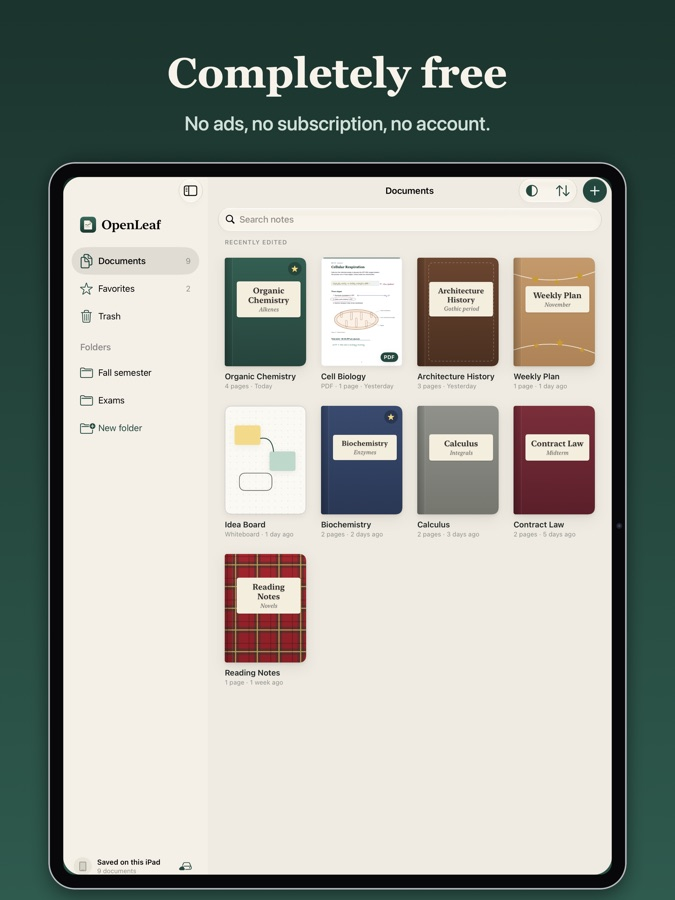
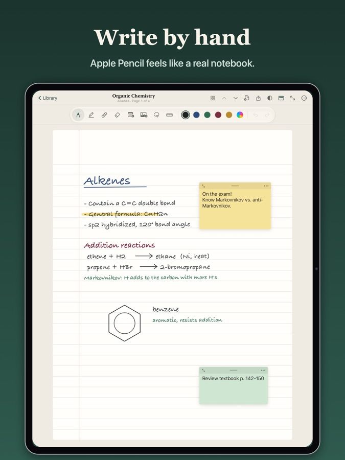
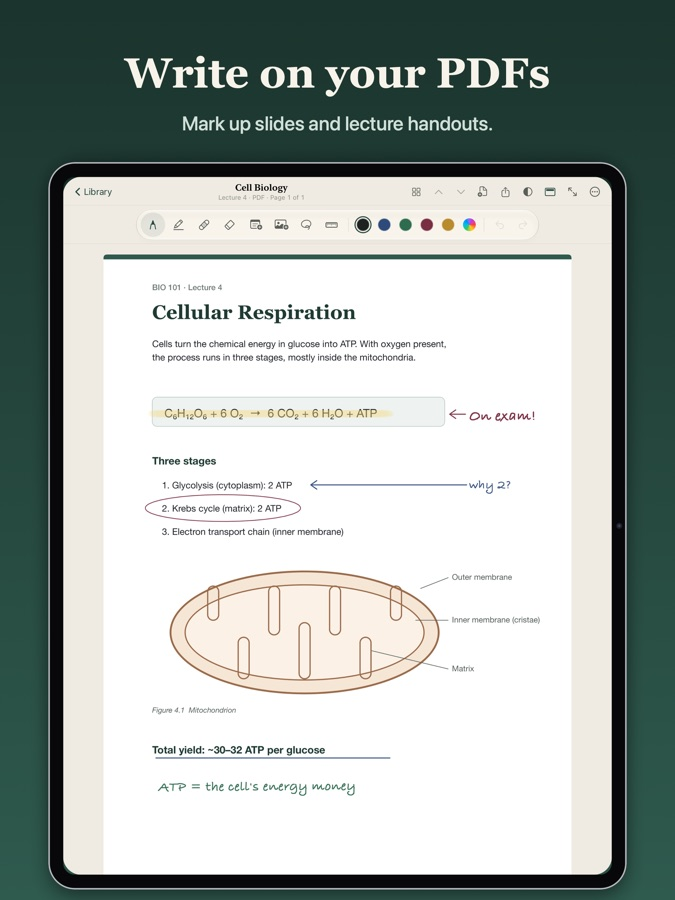
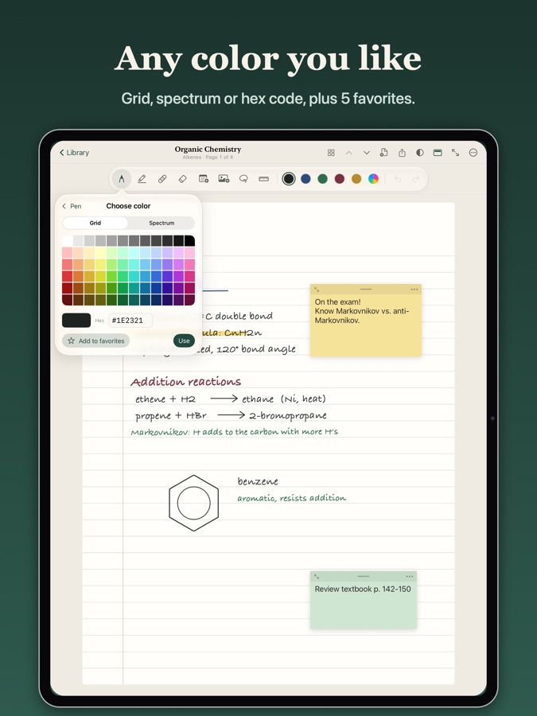

# OpenLeaf

A free and open-source handwriting note app for students, built for iPad and Apple Pencil.
No ads, no subscription, no in-app purchases; your notes stay on your device, with an optional automatic backup to
your own iCloud or to a folder you choose. Available in English, Turkish, German, Spanish, French, Italian and Brazilian Portuguese.

<a href="https://apps.apple.com/app/id6832556915"></a>

<p>
  
  
  
  
</p>

## Features

- **Library:** notebook covers with real materials (linen, leather, kraft…), folders, favorites, trash, search, sorting
- **New notebook:** 8 covers, A4 / A5 / Letter; templates: lined, grid, dotted, blank, Cornell, graph paper, music staves, weekly plan, timetable, topic tracker, mock exam review
- **Writing (PencilKit):** ballpoint, fountain, pencil and brush pens; adjustable thickness; highlighter; lasso
- **Pen colors:** any of 16.7 million colors from a grid, a spectrum or a hex code; five favorite colors you can swap and a row of recent colors
- **Eraser:** a partial eraser that removes only what the circle touches (adjustable size), or a whole-stroke eraser
- **Tape:** covers your notes and reveals them on tap, for quizzing yourself; strip or box, four colors
- **Ruler:** the PencilKit ruler for straight lines
- **Apple Pencil:** double-tap to switch to the eraser; squeeze Apple Pencil Pro for a radial quick menu
- **Pencil-only drawing:** your finger scrolls the page and turns pages with one or two fingers
- **Pinch to zoom** (up to 4×, paper and PDFs stay sharp at every zoom level)
- **Sticky notes:** type or handwrite, move, resize from the corner, change color
- **Photos and images:** take a photo or pick one from your library; move, resize, write on top
- **Pages:** book-style page curl, overview (thumbnail grid), drag to reorder, duplicate
- **PDF:** import, write on pages, "Open In → OpenLeaf", export any notebook as a PDF
- **Automatic backup** (off by default): to your own iCloud, or to any folder you pick in Files (Google Drive, Dropbox,
  OneDrive, a USB drive…); only changed pages are uploaded, and a fresh install offers to restore
- **iPad sync** (off by default): keeps your notebooks in step between your iPads through a private CloudKit database in your
  own iCloud; conflicting handwriting keeps both versions (one as a conflict copy), and a page edited on one iPad while
  deleted on another is rescued instead of lost
- **Manual backup:** the whole library as a single file to Files / iCloud Drive; restore from a backup
- **First-launch tour:** five short pages introducing the app, ending with the backup choice; can be reopened from the menu
- Light and dark themes; interface in English, Turkish, German, Spanish, French, Italian and Brazilian Portuguese; no ads, subscription or account

## Requirements

- Xcode 26 or later
- iPadOS / iOS 18 or later (the Liquid Glass look needs iPadOS 26 or later)

## Running

1. Open `OpenLeaf.xcodeproj` in Xcode.
2. Pick an iPad simulator or a device.
3. Press Run (⌘R).

To build for the simulator from the command line:

```bash
xcodebuild -project OpenLeaf.xcodeproj -scheme OpenLeaf -destination 'platform=iOS Simulator,name=iPad Air 11-inch (M4)' -derivedDataPath build CODE_SIGNING_ALLOWED=NO build
```

The backup engine has its own checks, which run on the Mac without Xcode's test runner:

```bash
swiftc OpenLeaf/BackupEngine.swift Tests/BackupEngineCheck/main.swift -o /tmp/backup-check && /tmp/backup-check
```

The sync merge logic has its own check too:

```bash
swiftc OpenLeaf/SyncMerge.swift OpenLeaf/SyncState.swift Tests/SyncCheck/main.swift -o /tmp/sync-check && /tmp/sync-check
```

Building for a device needs your own Apple developer team and iCloud container: change the bundle identifier and the
container name in `OpenLeaf.entitlements`, or drop the file together with the `CODE_SIGN_ENTITLEMENTS` build setting to
build without iCloud (backup to a chosen folder still works).

## Project structure

| File | Contents |
| --- | --- |
| `OpenLeaf/OpenLeafApp.swift` | App entry point |
| `OpenLeaf/Theme.swift` | Design tokens (colors, corners, motion, glass) |
| `OpenLeaf/Models.swift` | Notebook and page model, library (UI state) |
| `OpenLeaf/Storage.swift` | Local file store and migration of old saves |
| `OpenLeaf/LibraryView.swift` | Library screen |
| `OpenLeaf/NewNotebookSheet.swift` | New notebook sheet |
| `OpenLeaf/DocumentView.swift` | Note-taking screen and toolbar |
| `OpenLeaf/Canvas.swift` | PencilKit canvas and paper patterns |
| `OpenLeaf/CoverView.swift` | Covers and logo |
| `OpenLeaf/PDFSupport.swift` | PDF import, page rendering, thumbnails, export |
| `OpenLeaf/Templates.swift` | Page templates (Cornell, planners, exam tables) |
| `OpenLeaf/Tapes.swift` | Tapes: model, drawing, view |
| `OpenLeaf/StickyNotes.swift` | Sticky notes (text and ink layer) |
| `OpenLeaf/PageImages.swift` | Images on a page, selection, camera |
| `OpenLeaf/PageOverview.swift` | Page overview and reordering |
| `OpenLeaf/QuickPalette.swift` | Apple Pencil Pro squeeze menu |
| `OpenLeaf/Backup.swift` | Manual backup and restore |
| `OpenLeaf/BackupEngine.swift` | Mirrors the library to a backup folder and copies it back (Foundation only) |
| `OpenLeaf/AutoBackup.swift` | Automatic backup: destination (iCloud or a chosen folder), triggers, status, restore |
| `OpenLeaf/AutoBackupView.swift` | Automatic backup settings sheet |
| `OpenLeaf/SyncMerge.swift` | Three-way merge logic for sync (Foundation only) |
| `OpenLeaf/SyncState.swift` | Sync state store |
| `OpenLeaf/SyncRecords.swift` | CloudKit record conversion |
| `OpenLeaf/SyncController.swift` | CKSyncEngine driver |
| `OpenLeaf/SyncApply.swift` | Applies fetched changes to the library |
| `OpenLeaf/LibrarySync.swift` | Library hooks for sync |
| `OpenLeaf/SyncView.swift` | Sync menu and notices |
| `OpenLeaf/Onboarding.swift` | First-launch tour |
| `OpenLeaf-Info.plist` | PDF document type registration |
| `OpenLeaf.entitlements` | iCloud container for automatic backup |
| `Tests/BackupEngineCheck/main.swift` | Checks for the backup engine (run on the Mac, see below) |
| `Tests/SyncCheck/main.swift` | Checks for the sync merge logic (run on the Mac) |
| `Tests/SyncRecordsCheck/main.swift` | Checks for CloudKit record conversion (run on the Mac) |

The code comments and the source strings are in Turkish; the other languages come from the string catalog
(`OpenLeaf/Localizable.xcstrings`).

## How data is stored

Everything is kept on the device, in the app's Documents folder; there is no server.

```
OpenLeaf/
  index.json                library index (notebook info, page lists, notes, tapes, image positions)
  folders.json              folders
  Defterler/<notebook-id>/
    <page-id>.drawing       each page's ink (PencilKit)
    source.pdf              the imported PDF
    text.txt                the PDF's searchable text
    img-<id>.jpg            images added to pages
    thumb.png               thumbnail with ink
```

When you draw a stroke, only that page's file is written. Writes go through a single serial queue and are
atomic; pending saves are flushed when the app moves to the background. The single-file save of the first
version (`yaprak-kutuphane.json`) is migrated automatically on first launch and kept as
`yaprak-kutuphane.eski.json`.

### Automatic backup

When the user turns it on, the same files are mirrored to a backup folder, one folder per device so that two iPads
never overwrite each other:

```
<iCloud container>/Yedekler/<device-id>/          iCloud (not under Documents, so it is hidden from Files)
<chosen folder>/OpenLeaf Yedekleri/<device-id>/   a folder picked in Files
  cihaz.json                which device, when it last changed
  index.json, folders.json
  Defterler/<notebook-id>/  ink, PDF, text and images (no thumbnails)
```

The backup only reads the local store. A notebook is removed from the backup only after the user deletes it
permanently; an empty or damaged local library never wipes the backup. The index is written last, so an interrupted
backup leaves the previous one valid. Restoring adds the notebooks that are missing and never overwrites local files.

## Privacy

OpenLeaf collects no data. Backups and iPad sync go only to the user's own iCloud account (sync uses its private CloudKit database) or, for backups, a chosen folder. See [PRIVACY.md](PRIVACY.md).

## License

OpenLeaf is free software released under the [GNU General Public License version 3](LICENSE) (GPL-3.0).

You may use, modify and share the code. If you distribute a modified version, you must publish its
source code under the same license, so that apps derived from OpenLeaf stay free for students too.

Copyright (C) 2026 biggypanda

This program is free software: you can redistribute it and/or modify it under the terms of the
GNU General Public License as published by the Free Software Foundation, either version 3 of the
License, or (at your option) any later version. This program is distributed in the hope that it
will be useful, but WITHOUT ANY WARRANTY; without even the implied warranty of MERCHANTABILITY or
FITNESS FOR A PARTICULAR PURPOSE. See the GNU General Public License for more details.
